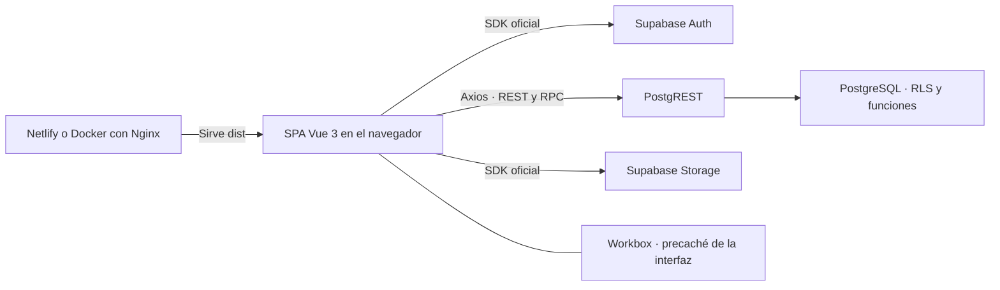

# RecetAPIs

RecetAPIs es un recetario colaborativo. Cualquier visitante puede consultar el catálogo y las personas registradas pueden proponer recetas o cambios. Un administrador revisa las propuestas antes de publicarlas. El versionado permite corregir una receta sin interrumpir la consulta de su versión publicada.

- [Repositorio público en GitHub](https://github.com/ferrufinofranco/RecetAPIs)
- [Sitio desplegado en Netlify](https://recetapis.netlify.app/) · La portada devolvió HTTP 401 en la consulta sin sesión del 13/11/2026.
- [Guion de defensa](docs/defensa.md) · [Checklist y pendientes](docs/checklist-tp.md) · [Preguntas y respuestas](docs/preguntas-defensa.md)

## Arquitectura y tecnologías



| Capa | Responsabilidad |
| --- | --- |
| Vue 3, Vite, Vue Router y Pinia | Componentes y vistas, compilación, navegación y estado de autenticación. El proyecto combina JavaScript y TypeScript. |
| Supabase Auth y Axios | El SDK administra la sesión. Axios llama a `/rest/v1/` con la clave publicable y agrega el JWT del usuario cuando hay sesión. |
| PostgreSQL y PostgREST | Las políticas Row Level Security (RLS) determinan qué filas puede consultar cada actor. Las funciones RPC validan autoría o rol y aplican transiciones de negocio. |
| Supabase Storage | Imágenes de recetas en el bucket público `recetas-imagenes`. La visibilidad del archivo por URL es independiente de la visibilidad de la receta. |
| Vite PWA y Workbox | Manifest, íconos, service worker y actualización confirmada por el usuario. |
| Vitest, Vue Test Utils y `node:test` | Pruebas de componentes, navegación y contratos de cliente. La suite real de RLS se ejecuta aparte. |

La aplicación estática se sirve desde Netlify o Nginx. El navegador se comunica directamente con Supabase. Las consultas y escrituras están en [`src/services/`](src/services/) y el esquema, las políticas y las funciones de referencia están en [`supabase/migrations/`](supabase/migrations/). Los guards de [Vue Router](src/router/authGuard.js) controlan el acceso a las pantallas. Supabase aplica la autorización a las peticiones.

## Funcionalidades por rol

| Rol | Funcionalidades |
| --- | --- |
| Visitante | Consultar el catálogo de recetas publicadas, buscar por título, filtrar por categoría, abrir el detalle, registrarse e iniciar sesión. |
| Usuario | Crear recetas con categorías, ingredientes, pasos ordenados e imagen opcional. Consultar estados y motivos en **Mis recetas**, editar propuestas pendientes, corregir rechazos, proponer cambios sobre publicaciones y dar de baja recetas propias. Solicitar ingredientes y consultar su estado desde **Crear receta**. |
| Administrador | Usar las funciones de una cuenta autenticada y acceder a `/admin` para aprobar o rechazar propuestas, gestionar categorías e ingredientes, resolver solicitudes y gestionar recetas. Puede dar de baja recetas y editar directamente una publicada cuando no hay propuesta pendiente. |

En administración, **General** está protegida. La baja de una categoría reasigna a General las versiones que quedarían sin categorías. Un ingrediente desactivado sigue visible en las recetas existentes. Una solicitud se puede aprobar creando un ingrediente, rechazar o asociar a un ingrediente activo existente.

## Aprobación y versionado

- `recetas` conserva la identidad y autoría. `receta_versiones` guarda el contenido y su estado. Las categorías, los ingredientes y los pasos se vinculan mediante `version_id`.
- El alta genera una versión `pendiente`. Editar una pendiente conserva su ID. Corregir una `rechazada` genera una nueva pendiente y conserva el rechazo con su motivo.
- Una propuesta sobre una receta publicada conserva la publicación vigente mientras se revisa. Al aprobarla, la versión previa pasa a `anterior` y la nueva a `publicada`. Si se rechaza, el catálogo sigue mostrando la publicación vigente. El enlace público conserva el ID de la receta.
- Una edición directa administrativa crea una nueva publicación y conserva la anterior. La baja lógica marca `eliminada_en`, descarta la propuesta pendiente si existe y retira la receta del catálogo.
- Las funciones SQL de referencia bloquean la fila de la receta para serializar cambios de versión. Índices únicos parciales limitan cada receta a una versión publicada y una pendiente.

## Instalación local

Requisitos: Node.js `^22.18.0 || >=24.12.0`, npm y acceso a un proyecto Supabase ya preparado con el esquema, las políticas, las RPC y el bucket de la aplicación. CI y Docker usan Node.js 24.19.0. Vite y Docker sirven el frontend. La preparación de Supabase corresponde al operador del proyecto.

```sh
git clone https://github.com/ferrufinofranco/RecetAPIs.git
cd RecetAPIs
npm ci
```

Creá un archivo `.env` en la raíz con los valores públicos de tu entorno. El ejemplo usa valores ficticios.

```dotenv
VITE_SUPABASE_URL=https://tu-proyecto.supabase.co
VITE_SUPABASE_PUBLISHABLE_KEY=sb_publishable_REEMPLAZAR
```

Las variables `VITE_*` quedan incluidas en el JavaScript del navegador. Reservá los secretos y las claves `service_role` para entornos de servidor. Si Supabase exige confirmación de email, la lista de redirects permitidos debe incluir la URL exacta de la app con `/login`, por ejemplo `http://localhost:5173/login`. Para probar el panel usá una cuenta administradora ya configurada. El registro crea perfiles con rol `usuario` mediante el trigger documentado.

```sh
npm run dev
```

Abrí [la aplicación local](http://localhost:5173/). En PowerShell podés usar `npm.cmd` si la ejecución de `npm.ps1` está restringida.

## Pruebas y compilación

```sh
npm test
npm run build
node tools/verificar-pwa.mjs
```

`npm test` ejecuta `test:unit` (Vitest con jsdom) y `test:legacy` (`node:test`). Las pruebas habituales usan dobles para Auth y REST. En la revisión del 13/11/2026 pasaron 155 pruebas Vitest y 78 de `node:test`, el chequeo de tipos, el build y la verificación estática de la PWA.

`npm run test:rls` es una suite aparte que escribe datos de prueba en Supabase. Requiere un proyecto exclusivo de testing y tres cuentas ya preparadas. El [informe de RLS](docs/integracion/pruebas-rls.md) registra ocho casos reales aprobados el 12/11/2026 en el entorno de testing autorizado. El [checklist](docs/checklist-tp.md) detalla qué falta comprobar en un entorno integrado.

## PWA

```sh
npm run build
npm run preview -- --host localhost --port 4173
```

Abrí [la vista previa](http://localhost:4173/) en un navegador compatible y buscá la opción de instalar RecetAPIs. El service worker se registra con un build de producción y requiere un contexto seguro, como HTTPS o localhost. El precaché cubre la interfaz compilada. Las recetas, el inicio de sesión y los guardados dependen de la conexión a Supabase. El aviso de actualización permite posponerla y bloquea la recarga si hay cambios sin guardar. Consultá el [protocolo de verificación en navegador](docs/PWA.md).

## Docker y Nginx

El [Dockerfile](Dockerfile) compila la SPA con Node y copia `dist/` a la imagen final de Nginx. Las variables públicas se incorporan en el build. Reconstruí la imagen para cambiar de proyecto Supabase.

```powershell
$env:VITE_SUPABASE_URL = Read-Host 'URL de Supabase'
$env:VITE_SUPABASE_PUBLISHABLE_KEY = Read-Host 'Clave publicable de Supabase'
docker build --build-arg VITE_SUPABASE_URL --build-arg VITE_SUPABASE_PUBLISHABLE_KEY -t recetapis:local .
docker run --rm -p 127.0.0.1:8080:80 recetapis:local
```

Abrí [la app en Nginx](http://localhost:8080/) y recargá `/login` para comprobar el fallback de la SPA. La [configuración de Nginx](nginx/default.conf) devuelve 404 para assets inexistentes y distingue la revalidación de HTML y archivos PWA de la caché de los assets con hash.

## GitHub Actions y Netlify

- [CI](.github/workflows/ci.yml) ejecuta instalación limpia, tests, build y verificación PWA en pushes y pull requests a `main`, y bajo ejecución manual.
- El job de despliegue se habilita tras CI exitoso para un push a `main` protegida. Compila el mismo commit con las variables de producción, verifica la PWA y comprueba que el commit siga en la punta de `main` antes de subir `dist/` con Netlify CLI. Usa las variables `VITE_SUPABASE_URL`, `VITE_SUPABASE_PUBLISHABLE_KEY`, `NETLIFY_SITE_ID` y el secreto `NETLIFY_AUTH_TOKEN` del entorno `production`. [Ejecución exitosa de CI y despliegue](https://github.com/ferrufinofranco/RecetAPIs/actions/runs/43477379995)
- [`netlify.toml`](netlify.toml) define el fallback a `index.html`, conserva la prioridad de los recursos existentes y configura la revalidación de caché.
- [Docker smoke](.github/workflows/docker-smoke.yml) es manual. Construye la imagen con configuración ficticia y comprueba Nginx, el fallback, los códigos HTTP y los archivos PWA. La suite real de RLS se ejecuta por separado de ambos workflows.

## Documentación técnica

- [Referencia de contratos REST/RPC, pruebas manuales y operación](docs/referencia-tecnica.md)
- [Auditoría de Supabase](docs/integracion/auditoria-supabase.md) e [inventario SQL de solo lectura](docs/integracion/inventario-solo-lectura.sql)
- [Protocolo de integración funcional](docs/integracion/protocolo-manual.md) e [informe de pruebas reales de RLS](docs/integracion/pruebas-rls.md)
